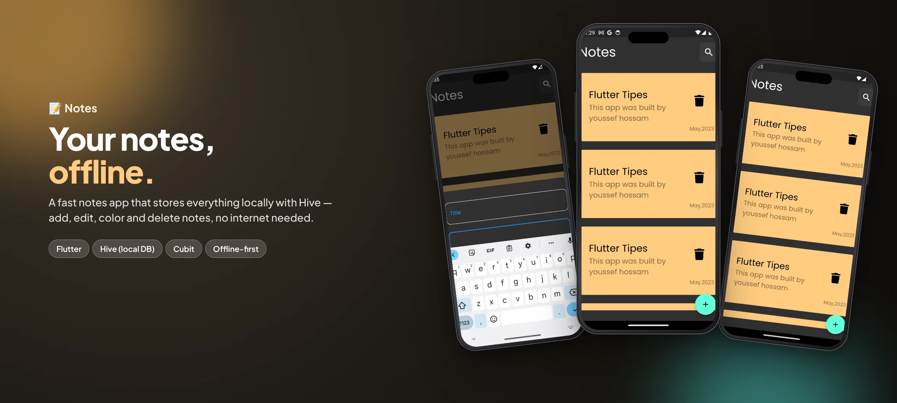
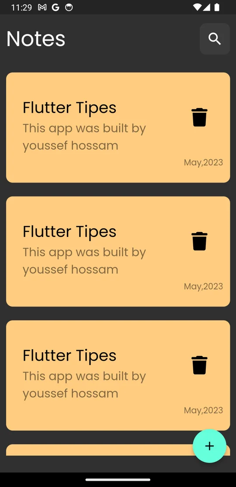
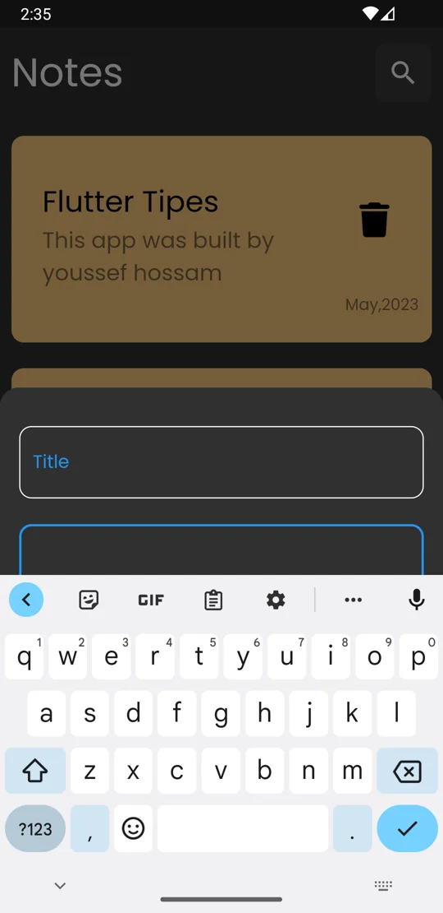
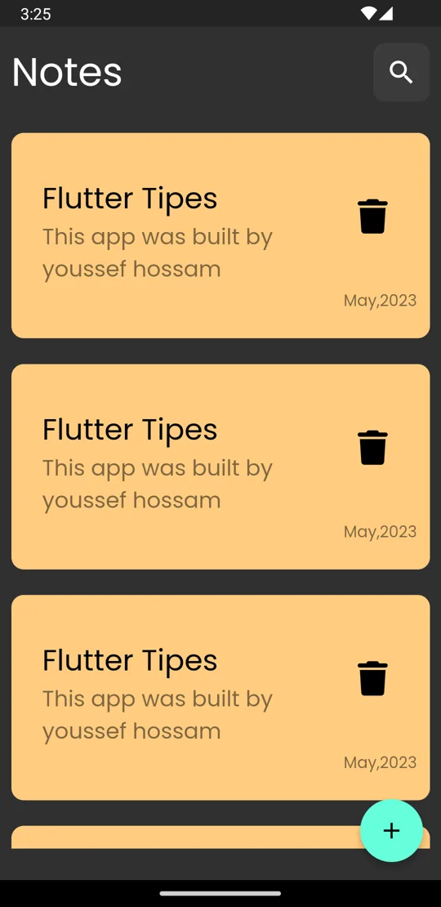

<h1 align="center">📝 Notes</h1>

<p align="center">
  A lightweight, <b>offline-first</b> notes app — create, edit, colour and delete notes, all stored locally with <b>Hive</b>.
</p>

<p align="center">
  
  
  
</p>

<p align="center">
  
</p>

## 📱 Screens

| Notes | Add note | Notes list |
|:-:|:-:|:-:|
|  |  |  |

## ✨ Features

- ➕ Add a note from a bottom sheet with title, content and a **colour picker**.
- ✏️ Edit any note, 🗑️ delete it with one tap.
- 📅 Each note keeps its creation date (formatted with `intl`).
- 💾 Works **fully offline** — data persists in a Hive box, no internet needed.

## 🏗️ How it's built

```
lib/
├── cubits/
│   ├── add_note_cubit/   # validates & saves a new note
│   └── notes_cubit/      # loads / refreshes the notes list
├── models/               # NoteModel + generated Hive TypeAdapter
├── views/                # notes list & edit screens
└── widgets/              # app bar, note item, colour list, forms…
```

- **State management:** Cubit (`flutter_bloc`) with a `BlocObserver` for logging.
- **Local storage:** `hive` + `hive_flutter` with a generated `TypeAdapter`.

## 🚀 Run it

```bash
flutter pub get
flutter run
```

---

<p align="center">Made with ❤️ by <a href="https://github.com/youssef-hossam">Youssef Hadwa</a></p>
